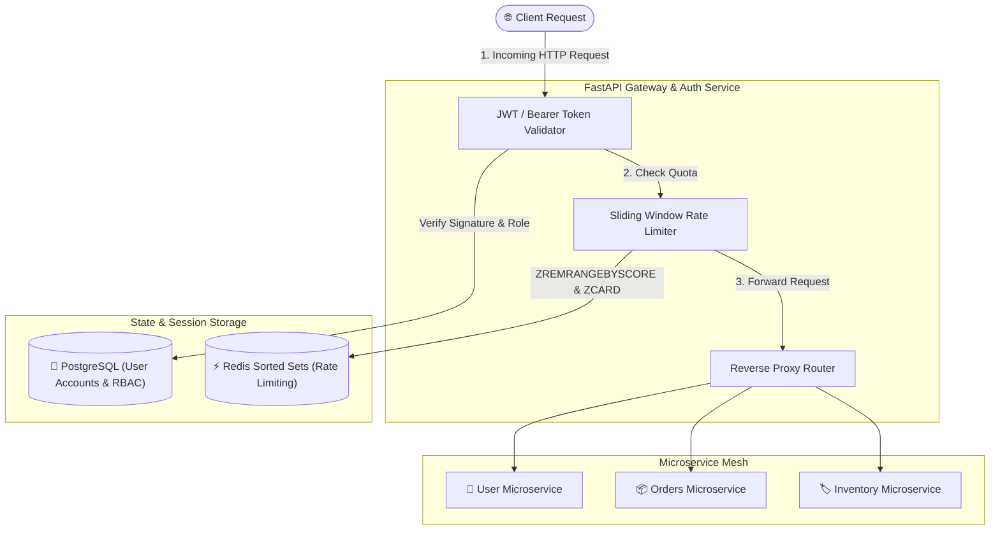

# 🔐 API Gateway & Auth Service

[](https://github.com/MSBHOSLE/api-gateway-auth-service/actions)
[](https://fastapi.tiangolo.com)
[](https://www.python.org/)
[](https://redis.io/)
[](https://jwt.io/)
[](https://www.docker.com/)
[](LICENSE)

A high-performance **API Gateway and Authentication Service** built with **FastAPI**, **Redis**, and **PostgreSQL**. Features **JWT Role-Based Access Control (RBAC)**, dynamic reverse-proxy request forwarding, and a **Redis-backed sliding window rate limiter**.

---

## 🏗️ Architecture



---

## ⚡ Core Engineering Features

1. **Sliding Window Rate Limiting (Redis Sorted Sets)**:
   - Eliminates the boundary-burst vulnerability of fixed-window counters.
   - Computes real-time consumption via `ZREMRANGEBYSCORE` and `ZCARD` with automatic TTL pruning.
   - Injects standard HTTP headers: `X-RateLimit-Limit`, `X-RateLimit-Remaining`, and `X-RateLimit-Reset`.

2. **JWT Authentication & RBAC**:
   - Short-lived signed access tokens (`HS256`) + long-lived refresh tokens.
   - Fine-grained Role-Based Access Control (`admin`, `service`, `user`).
   - PBKDF2-HMAC-SHA256 password hashing with 100,000 salt iterations.

3. **Reverse Proxying**:
   - Forwards client requests, payload streams, and headers to downstream microservices.

---

## 🚀 Quickstart

```bash
git clone https://github.com/MSBHOSLE/api-gateway-auth-service.git
cd api-gateway-auth-service

# Start with Docker Compose
docker compose up -d --build
```

---

## 📡 API Reference

| Method | Endpoint | Description |
| :--- | :--- | :--- |
| `POST` | `/api/v1/auth/register` | Register new user account |
| `POST` | `/api/v1/auth/login` | Authenticate and obtain Access + Refresh tokens |
| `POST` | `/api/v1/auth/refresh` | Rotate access token via refresh token |
| `GET` | `/api/v1/auth/me` | Fetch authenticated user profile & roles |
| `ALL` | `/api/v1/proxy/{path}` | Reverse proxy gateway endpoint with sliding-window limit |
| `GET` | `/health` | Gateway health probe |

---

## 🧪 Testing

```bash
python -m unittest discover tests
```

---

## 👤 Author

**Mahesh Sanjayrao Bhosle**
- **GitHub:** [@MSBHOSLE](https://github.com/MSBHOSLE)
- **LinkedIn:** [Mahesh Bhosle](https://linkedin.com/in/mahesh-bhosle-916991198)
- **Email:** msbhosle.2@gmail.com
- **Education:** M.Sc. Data & Computer Science, Heidelberg University

---

## 📄 License

This project is licensed under the MIT License - see the [LICENSE](LICENSE) file for details.
